<p align="center">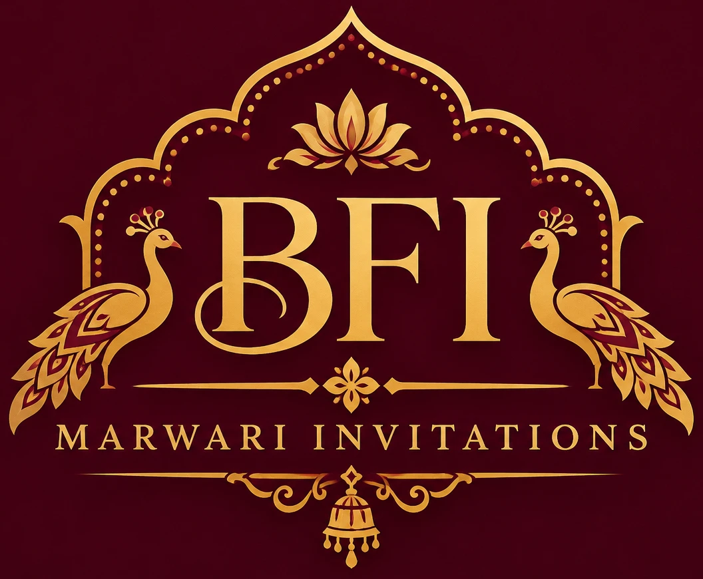</p>

# BFI — Marwari Invitations

Premium digital wedding invitations for Marwari families: every ritual, every elder's name, delivered as a beautiful invitation website that families share on WhatsApp.

This repository holds the brand, the design mockups, the product docs and the studio app.

| Folder | What's inside |
|---|---|
| [`DESIGN.md`](DESIGN.md) | **Royal Heritage website spec**: tokens, typography, motifs, components, 7 pages, image & Rajasthani illustration list with AI prompts, Figma vs Canva, MCP workflow |
| [`brand/`](brand) | Logo files, monogram, app icons, favicons and the WhatsApp/social share image |
| [`design/`](design) | **Mockups of every page** (website + app), desktop and mobile, in the Royal Marwari design. Open [`design/index.html`](design/index.html) in a browser for the gallery |
| [`docs/`](docs) | Design audit, design system, PRD, database design, go-to-market plan, launch checklist |
| [`app/`](app) | The current studio & client app (installable web app). Live demo: https://bfi-marwari-invitations.vercel.app |

## Design · Royal Marwari

| Colour | HEX | Use |
|---|---|---|
| Deep maroon | `#460013` | Logo background, hero bands, footer |
| Maroon | `#641E2B` | Primary buttons, headings accent |
| Antique gold | `#C6A15B` | Ornaments, borders, accents on maroon |
| Gold ink | `#7E5F24` | Small gold text on light backgrounds |
| Ivory | `#FFF8EC` | Page background |
| Warm beige | `#E9DCC8` | Sections, borders |
| Deep brown | `#392820` | Body text |

Typography: **Cormorant Garamond** (headings) · **Inter** (body) · **Tiro Devanagari Hindi** (one ceremonial line per page).
Why this direction: see [`docs/01-design-audit.md`](docs/01-design-audit.md).

## Four homepage concepts

Same content and logo, four different design directions. Compare them in [`design/concepts/index.html`](design/concepts/index.html).

| 1 · Darbar: dark royal palace | 2 · Kankotri: ivory editorial |
|---|---|
| 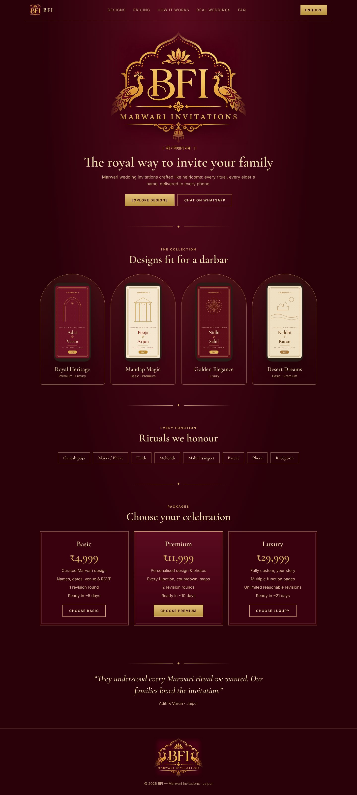 | 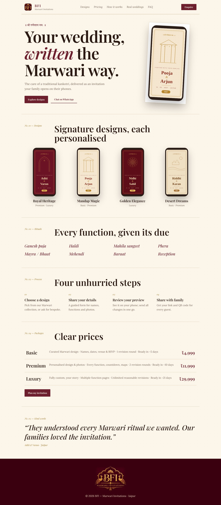 |
| **3 · Gulabi: modern luxury** | **4 · Utsav: festive celebration** |
| 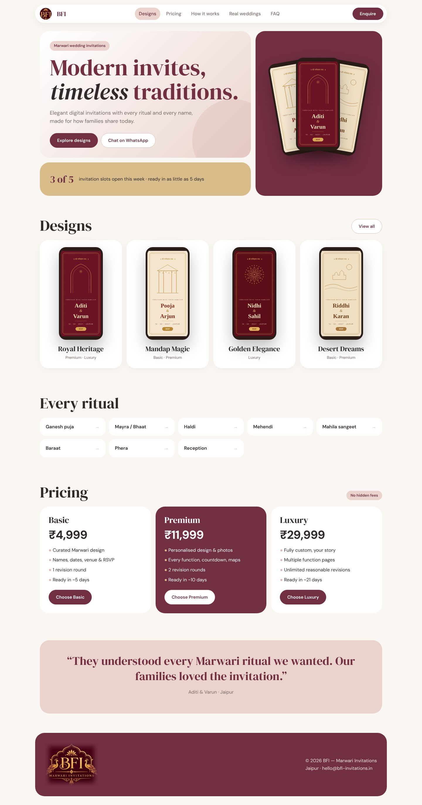 | 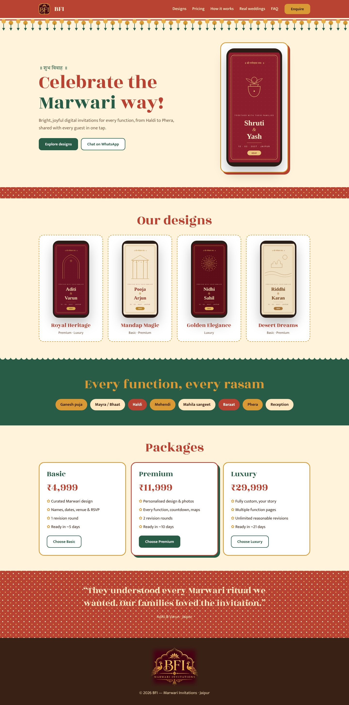 |

Mobile versions: `design/screens/mobile/concept-*.jpg`. Regenerate with `python3 design/build_concepts.py`.

**Single-file versions** (logo and scripts embedded; open anywhere, share by WhatsApp or email): [`design/concepts/standalone/`](design/concepts/standalone).

## Mockups (Royal Marwari, all pages)

**Homepage** — desktop and mobile

<p>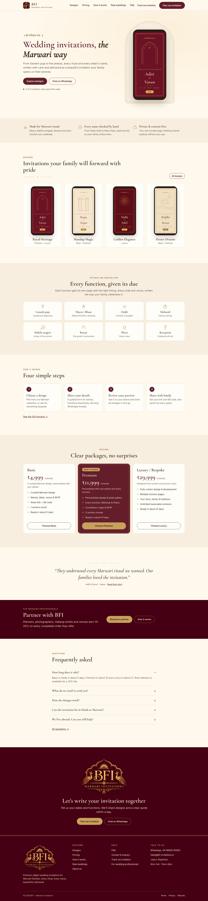 </p>

**Design detail** · **Pricing**

<p>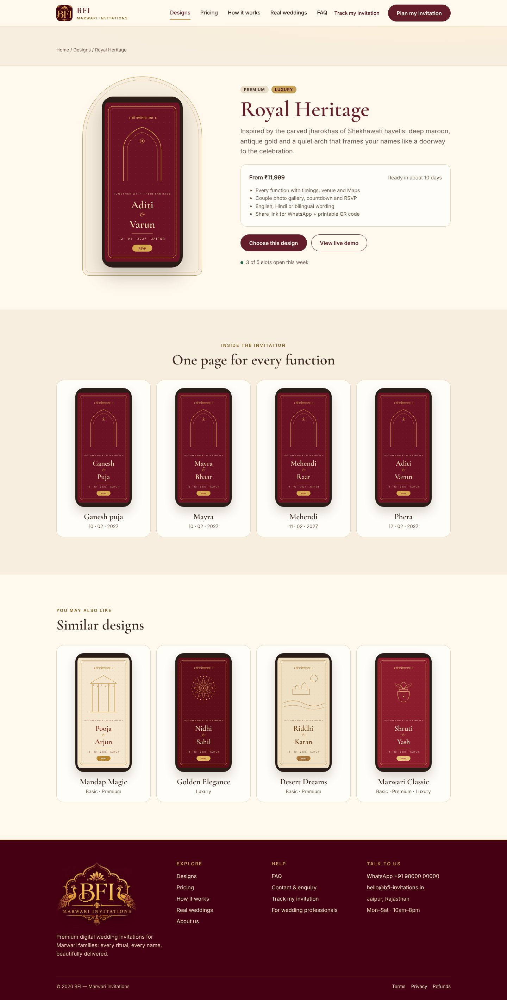 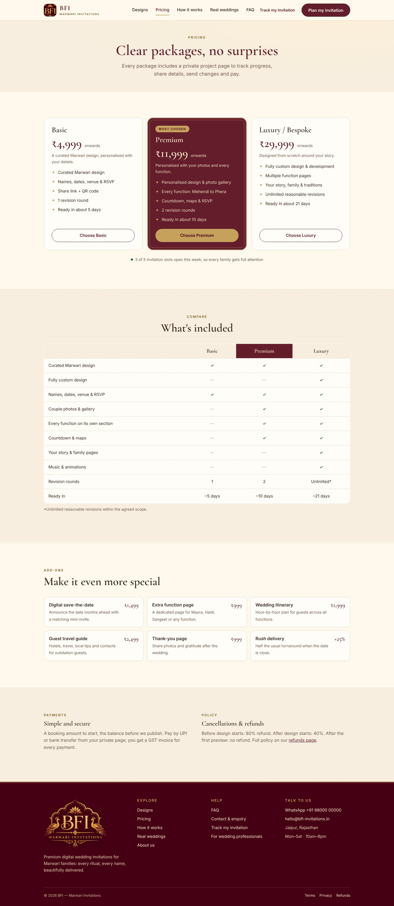</p>

**Client portal** (dashboard · messages with @tags) · **Studio** (admin dashboard)

<p>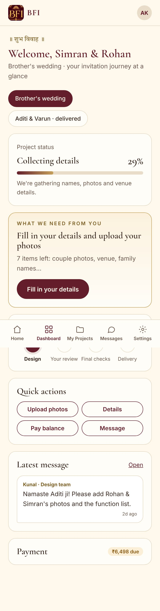 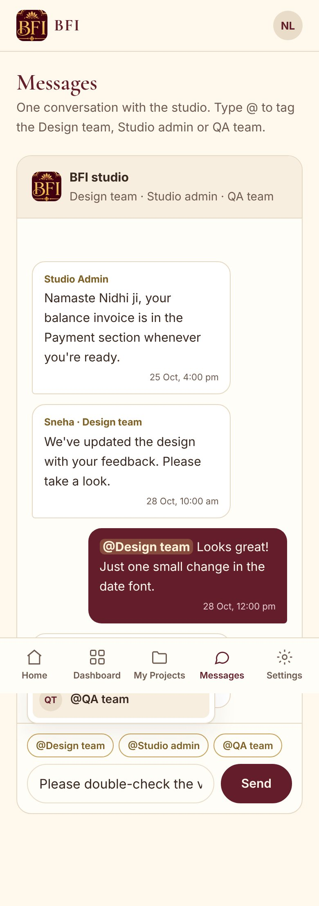 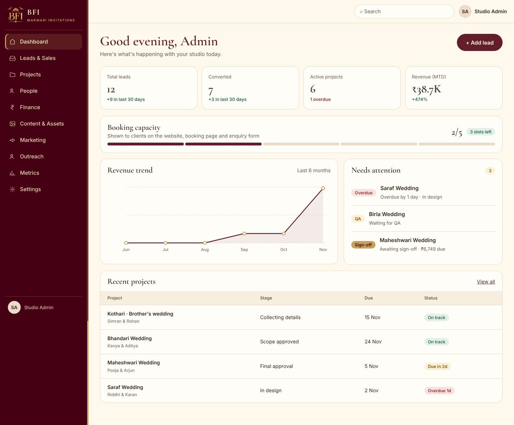</p>

All 19 pages: Home, Designs, Design detail, Pricing, How it works, Real weddings, About, FAQ, Partners, Plan my invitation, Track my invitation, Legal · Client dashboard, My project, Messages · Studio dashboard, Leads, Design workspace · Partner home. Images in [`design/screens/`](design/screens).

## Working on the mockups

The pages are plain HTML/CSS with no build step:

```bash
python3 design/build_site.py   # regenerates design/website/*.html
python3 design/build_app.py    # regenerates design/app/*.html
python3 -m http.server 8000    # then open http://localhost:8000/design/
```

Shared styles: `design/assets/bfi.css` (design system) and `design/assets/app.css` (app screens). Header, footer and invitation previews come from `design/assets/mock.js`.

## Status

- ✅ Brand direction (Royal Marwari) and logo
- ✅ Mockups for every website and app page
- ✅ Product docs and sales plan
- ⏳ Build the real website at `/` and move the app to `/app` (keeps every existing link working)
- ⏳ Shared database (Supabase) and real sign-in
- ⏳ Go-live checklist (legal pages, commercial hosting, domain)
